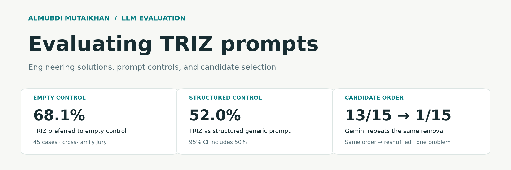
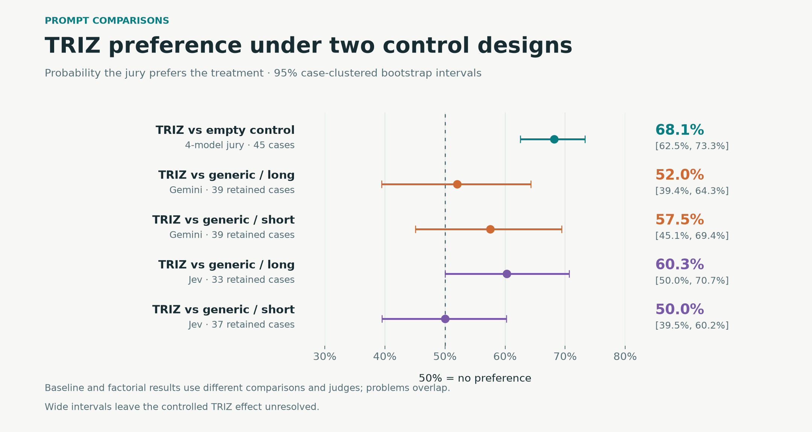
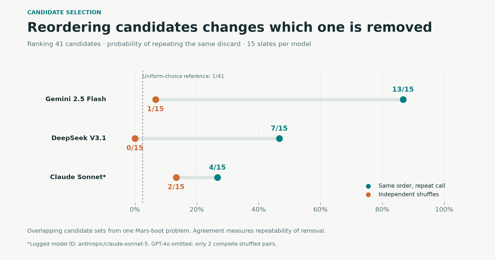
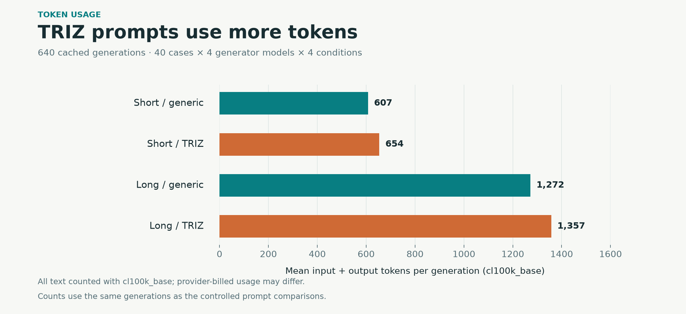
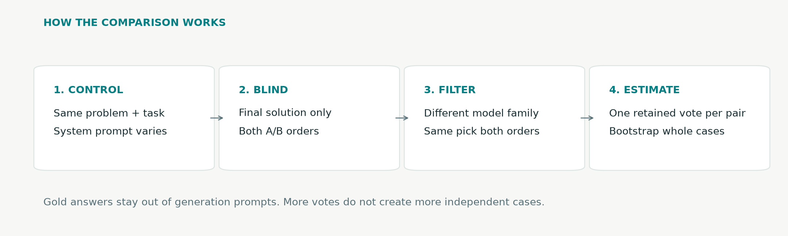

**[Almubdi Mutaikhan](https://github.com/almubdimutaikhan)** · LLM evaluation and creative problem solving

I tested whether TRIZ, a method for inventive problem solving, helps LLMs propose engineering solutions. This repo brings together the prompt comparisons, a follow-up with stronger controls, and experiments on how models select ideas.

[Results](results/RESULTS.md) · [Method](docs/METHOD.md) · [Analysis checks](docs/AUDIT.md) · [Sources](docs/RELATED_WORK.md)



TRIZ was preferred to an empty control in **68.1%** of retained votes. Against a structured generic prompt, Gemini preferred TRIZ in **52.0% [39.4%, 64.3%]**; Jev gave **60.3% [50.0%, 70.7%]**. The controlled comparisons leave the TRIZ effect unresolved.



Gemini repeated the same removal **13/15** times with candidate order fixed, versus **1/15** after reshuffling. These are overlapping candidate sets from one problem, so the result is a case study of selection reliability.



The controlled study contains **40 cases, 4 generator models, and 640 generations**. I counted input and output tokens with the same tokenizer across models.



**Reproduce the analysis** (Python 3.12+, no API key):

```bash
python scripts/analyze.py                 # check hashes and rebuild statistics
python -m unittest discover -s tests
pip install -r requirements.txt
python scripts/figures.py                 # rebuild figures
```

The [released data](evidence/README.md) contains judgement records and token counts. Original prompts and model text are excluded; rerunning model inference requires the source data.

Next: [test evaluation reliability in Kazakh and English](docs/RESEARCH_DIRECTION.md), building on my [Kazakh tokenizer audit](https://github.com/almubdimutaikhan/kazakh-vocab-extension-audit).

Source experiments: [TRIZ-2AFC](https://github.com/almubdimutaikhan/triz-2afc-agent-framework) · [BVSR](https://github.com/almubdimutaikhan/bvrs-llm-creativity). Related work and coauthor credits: [sources](docs/RELATED_WORK.md).

The companion [LLM judge reliability](https://github.com/almubdimutaikhan/llm-judge-reliability) repo examines judge–generator preferences and repeatability in creative ranking and selection.
